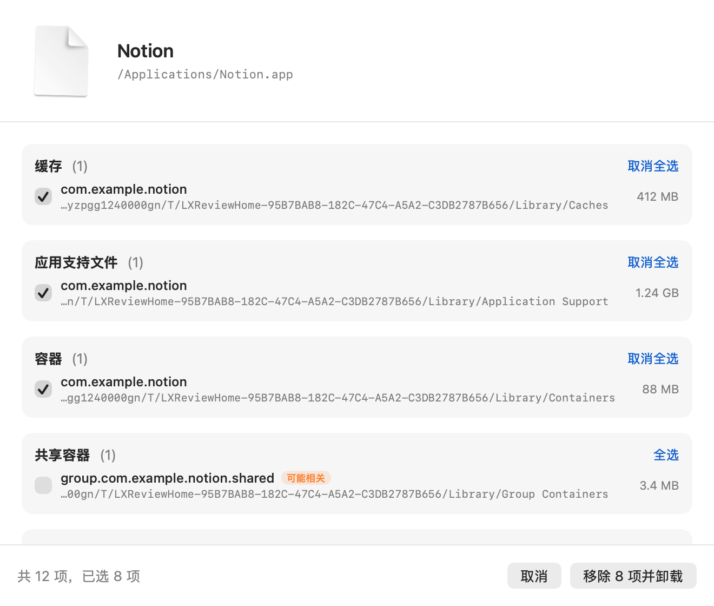
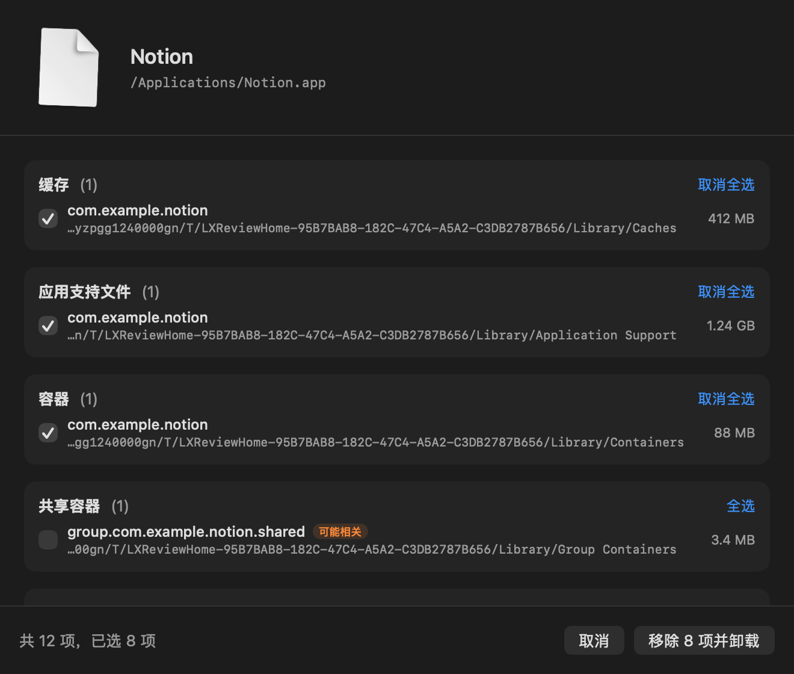
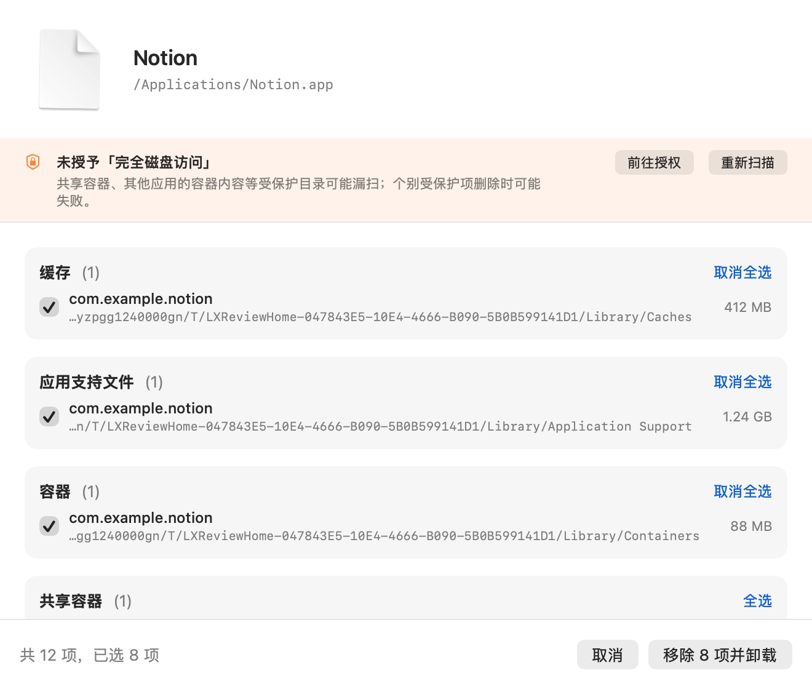
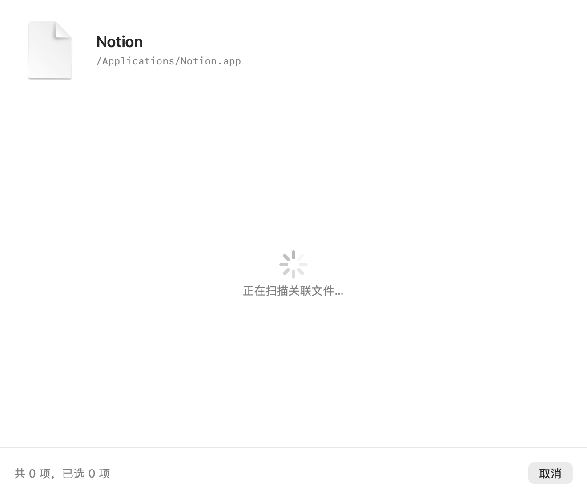
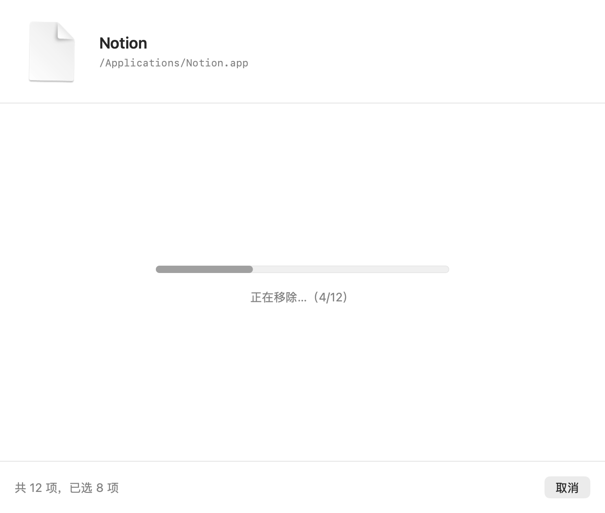
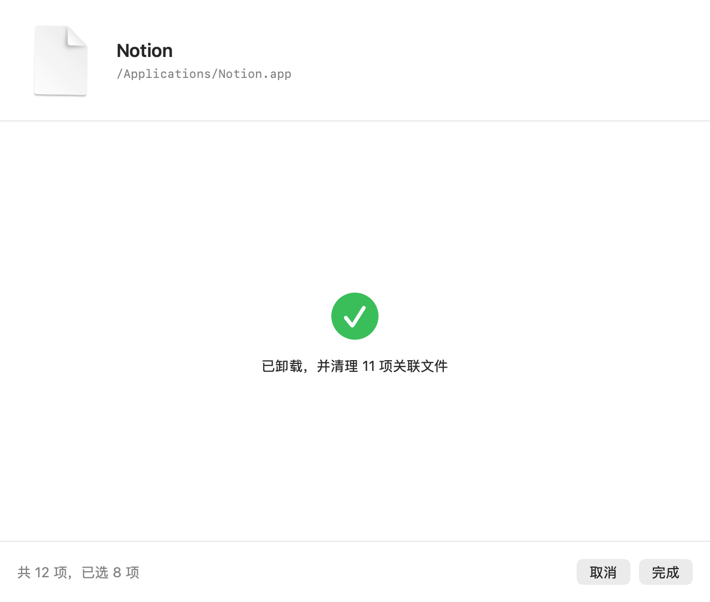
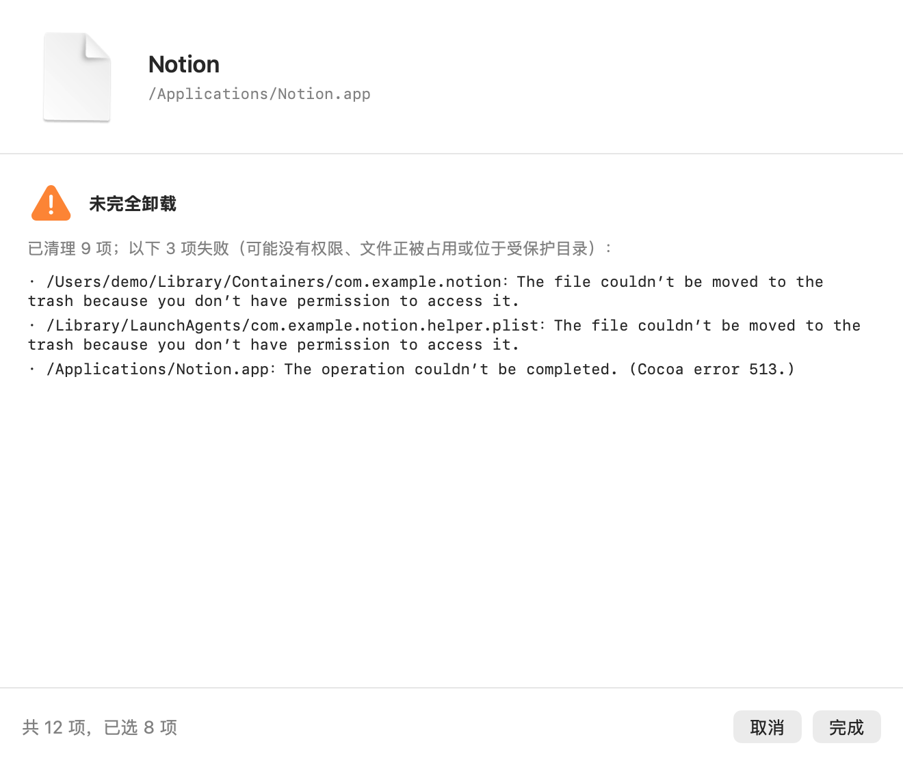
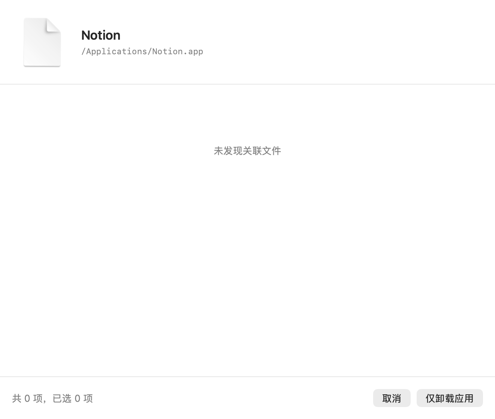

# 卸载器（Uninstall）UI / UX 评审

- 评审对象：LaunchX 卸载器 —— `Sources/LaunchXCore/Uninstaller/`（UninstallWindow 639 行 / UninstallScanner 454 行）及其入口（右键菜单、AppDelegate 装配、Launchpad 窗口层级）。
- 评审方式：通读实现 + 在离屏 `NSWindow`/NSHostingView 中按真实数据渲染 8 帧、覆盖 6 个状态（见下方截图），结合 macOS HIG、卸载类工具的信息需求、以及本项目既有的交互约定（`AppCell` / `WindowFade` / `LXColors`）。
- 局限：未在真实权限、真实删除、VoiceOver、指针交互下逐项手测；动画时长与键盘焦点只做了代码层判断。文中标注「待确认」的条目需实机验证。
- 截图说明：为评审临时构造的假 home（12 项、8 项选中）离屏渲染，仅用于观察信息层级与状态差异，不代表真实扫描结果。

**总评：5.3 / 10** —— 安全底座（白名单、废纸篓、默认不勾风险项）做得比多数同类工具扎实，但"用户能否看懂、能否后悔、能否判断结果"这三件事上缺口明显：没有空间账本、没有撤销入口、删除中可"取消"、失败页不回答"应用还在不在"。属于**可信但不好用**的卸载器。

| 维度 | 分数 | 一句话 |
| --- | --- | --- |
| 决策信息（大小/后果/影响面） | 4 / 10 | 只有项数，没有字节；应用本身体积不可见 |
| 危险操作安全与可逆性 | 6 / 10 | 走废纸篓、默认不勾风险项；但无撤销入口、可中途"取消"失败 |
| 状态反馈与进度 | 5 / 10 | 扫描/删除只有转圈与计数；完成页残留旧计数 |
| 交互与平台一致性 | 6 / 10 | 原生控件、右键入口合理；缺键盘、缩放、回落逻辑 |
| 视觉与品牌一致性 | 6 / 10 | 干净的默认卡片风，但与玻璃拟态主界面是两套语言 |
| 可访问性 | 5 / 10 | 复选框有标签；但动效忽略「减弱动态效果」、14 个同名「全选」 |

---

## 一、现状还原

`UninstallWindowController.show(app:layoutStore:)` 每次复用同一窗口并新建 `UninstallModel`，随即自动 `startScan()`。状态机：`idle → scanning → ready → removing → done | partialFailure`。

### 1. ready（清单可操作）





- 头部：72pt 应用图标（持续抖动）+ 名称 + 等宽路径。
- 主体：按类目分组的浅灰卡片，每行 = 复选框 + 条目名 + 父目录（头部截断）+ 大小；模糊命中项带「可能相关」橙色徽标。
- 底部：`共 N 项，已选 M 项` + 取消 + 主按钮「移除 M 项并卸载 / 仅卸载应用」。

### 2. 未授予「完全磁盘访问」（非阻断横幅）



### 3. scanning / removing





### 4. done / partialFailure





### 5. 空清单



> 截图 06/07 直接暴露两个状态机问题：完成页底部仍显示 **「共 12 项，已选 8 项」**（过期数据），并且同时出现 **「取消」「完成」** 两个按钮；扫描页底部同样是 **「共 0 项，已选 0 项」**。

---

## 二、做得好的地方（不要改掉）

1. **默认勾选策略克制**：只默认勾选"由 bundleId 精确派生"的项；名称模糊匹配、User Files、Launch Items 一律默认不勾（`UninstallWindow.swift:21-30`，`UninstallScanner.swift:59-61,112-118`）。这是卸载器最容易被做坏的地方，这里做对了。
2. **删除可逆**：全部通过 `NSWorkspace.recycle` 进废纸篓（`UninstallScanner.swift:321-337,376-386`），不做 `removeItem` 永久删除。
3. **路径安全**：扫描与删除两侧都有 `home` / `/Library` / `/Applications` 根目录白名单 + 目录边界匹配，能挡住畸形 `CFBundleIdentifier = "../.."` 这类越界（`UninstallScanner.swift:92-107,264-292`，`UninstallEngine.isSafeToTrash`）。
4. **失败不虚报**：关联文件删除显式检查回收站返回字典，未真正回收的项计入失败（`UninstallScanner.swift:376-386`）；`size(of:)` 区分「不可读」与「0 字节」（`294-318`）。
5. **FDA 不再整页阻断**：缺权限时照常扫描 + 顶部横幅说明"可能漏扫"（`UninstallWindow.swift:37-50,606-639`），比旧版"整页引导"可用性好得多。
6. **确认弹窗有防误触设计**：含个人文件时默认按钮切换为「取消」，并把命中的个人文件路径逐条列出（`436-476`）。
7. **重扫代际**：`scanGeneration` 丢弃迟到结果，窗口复用前 `reset()`（`52-54,74-81,96-105`）。
8. **部分失败明细可文本选择**（`366-376`），便于用户反馈/自查。

---

## 三、问题清单

共 4 个 P0、8 个 P1、12 个 P2、6 个 P3 打磨项。

严重度定义：**P0** = 会让用户对结果产生错误认知或造成数据/流程损失；**P1** = 关键信息或关键操作缺失，明显影响完成率；**P2** = 局部可用性/正确性缺陷；**P3** = 打磨项。

### P0

#### P0-1 删除进行中仍可「取消」或关闭窗口，但操作不会停止，失败明细还会丢失

- 现象：`.removing` 阶段底部仍显示「取消」，标题栏红灯也可点。点击后窗口淡出，删除任务继续跑；只有一条 3 秒 toast 汇总成功，`.partialFailure` 的逐条明细窗口已不可见。
- 证据：footer 无条件渲染「取消」（`UninstallWindow.swift:405-410`，done/partial 分支 `417-424`）；`onClose` 只做 `WindowFade.fadeOut`（`238-242`）；`windowShouldClose` 无阶段判断（`269-272`）；`removeChecked()` 的 `Task` 与窗口生命周期无关（`148-198`）。
- 影响：用户以为取消了，实际应用已被卸载；失败页被关掉后无法查看哪些项没删掉。这是整个功能里最容易引发"你赔我文件"投诉的路径。
- 建议：`.removing` 阶段**移除取消按钮**，关闭按钮改为「仍在删除，关闭将丢失失败明细」确认；或提供真正的「停止」——停止后续队列并如实汇报"已删除 X 项，剩余未处理"。同时把当前正在删除的项名显示在进度下。

#### P0-2 应用本体移废纸篓不校验返回值：拿到空字典也当作成功（真实触发条件需实机确认）

- 现象：`FinderActions.moveToTrash` 把 `recycle(_:)` 的返回字典转成数组，字典为空时返回 `[]` 且不抛错；`UninstallModel` 只判断是否抛错，只要没抛错就 `removedFromLayout = true`、删除布局条目、显示成功。`NSWorkspace.recycle` 在"部分 URL 未被接收"时以省略字典项表达（并不保证一定抛错），因此"返回空但无异常"是必须防御的输入；具体哪些应用会走到这条分支（SIP 保护、权限、只读卷、被占用）需在真机用受保护应用验证，**不要拿 Safari 实删**。
- 证据：`FinderActions.swift:194-205`（`return trashed.map { Array($0.values) } ?? []`，没有校验是否为空）；`UninstallWindow.swift:171-187`（`_ = try await ...moveToTrash`，忽略返回值）。对照关联文件路径 `UninstallScanner.swift:376-386` 是有空字典校验的——同一套语义在应用本体上失守。
- 影响：/Applications 下的 Apple 应用（本机 `/Applications/Safari.app`，`com.apple.Safari`）不走 `/System` 分支（`AppCell.swift:294`），菜单给的是「卸载」。一旦 recycle 返回空，用户得到"已卸载"，但应用仍在、Launchpad 里却没了——比直接失败更糟。
- 建议：应用本体也必须有"实际回收成功"判据：`moved[url] != nil` 才置成功；否则按失败处理（并把应用保留在布局里）。另外在入口处对 SIP 保护/系统应用做前置判定（见 P1-8）。

#### P0-3 部分失败页不回答「应用本体到底还在不在」，也没有任何后续动作

- 现象：`.partialFailure` 只给「已清理 9 项；以下 3 项失败（可能没有权限…）」+ 原始路径与系统错误。不说明应用本体是否已移走、应用是否还能启动；没有「重试失败项」「在访达中显示」「复制错误」「打开废纸篓」。
- 证据：`UninstallWindow.swift:354-379`（仅标题、说明、失败列表），`421-424`（只有「完成」）。
- 影响：这是卸载器最需要承担责任的时刻，现在用户只能自己猜。尤其"缓存已清、应用还在"（见 P0-2/P1-8）时，用户会以为卸载成功。
- 建议：失败页首行固定给出结论——「应用本体：已移入废纸篓 / 仍在 `/Applications/…`」；失败项按原因分组（无权限 / 被占用 / 受保护）；提供「重试失败项」「在访达中显示」「复制详情」。

#### P0-4 卸载正在运行的应用会静默退出、2 秒后强制退出，界面与确认弹窗从未提示

- 现象：`removeChecked()` 先 `waitForTermination`：逐个 `terminate()`，2 秒内未退出则 `forceTerminate()`（`UninstallWindow.swift:200-219`）；确认弹窗（`436-476`）和头部都没有"应用正在运行，将先退出"的提示。
- 影响：用户可能正在编辑文档时从 Launchpad 卸载该应用，未保存内容被强杀。这是数据丢失风险，不只是体验问题。
- 建议：打开窗口时就检测 `NSRunningApplication.runningApplications(withBundleIdentifier:)`，在头部显示「正在运行」徽标；确认弹窗追加一行「该应用正在运行，将先请求退出（未保存内容可能丢失）」。更稳妥：先只 `terminate()`，未退出则让用户选择「强制退出并继续 / 取消」。

### P1

#### P1-1 没有"空间账本"：应用本身体积、已选合计、实际释放量全部缺失

- 证据：清单只渲染单条 `item.byteSize`（`UninstallWindow.swift:574-578`），全文件无合计逻辑；头部只有路径（`310-325`）；`done` 只有「已清理 N 项」（`346-353`）。应用 bundle 自身大小从未计算。
- 影响：用户卸载的主要动机是"腾空间"，而这里量不出来。同类工具（CleanMyMac、Pearcleaner、AppCleaner）都把"将释放 X GB"放在最显眼处。
- 建议：header 或 footer 增加三段账本：**应用本体 512 MB + 已选关联 1.7 GB = 2.2 GB**；扫描完成后计算一次 bundle 大小（后台、可缓存）；完成页显示"已释放 X GB"。

#### P1-2 done / partialFailure 页的底部栏是坏的：过期计数 + 「取消」和「完成」并存

- 证据：计数行与「取消」按钮无条件渲染（`UninstallWindow.swift:407-410`），只有在 `done/partialFailure` 时追加「完成」（`417-424`）；截图 06/07 显示"已卸载"页面底部仍是「共 12 项，已选 8 项」。
- 影响：成功页出现"取消"按钮语义矛盾；旧计数让用户怀疑是否真的删干净了。
- 建议：footer 按阶段整体切换：`.ready` = 计数 + 取消 + 主按钮；`.removing` = 进度 + 无取消；`.done` = 「已释放 X GB」+ 完成（+ 查看废纸篓）；`.partialFailure` = 失败摘要 + 完成。计数只在 `.ready` 显示。

#### P1-3 全程没有"后悔药"入口：成功页不告诉用户可以从废纸篓恢复，也没有撤销/查看入口

- 证据：成功只发一条 toast「已卸载」（`UninstallWindow.swift:190-196`），`done` 视图只有对勾和文案（`346-353`）。
- 影响：项目最大的安全优势（走废纸篓、可恢复）在界面上完全不可见。用户会以为永久删除，要么不敢用，要么在误删后不知道怎么找回。
- 建议：成功页明确写「应用与关联文件已移到废纸篓，可从这里恢复」，提供「在废纸篓中查看」按钮；如果后续支持，可做一次性的"撤销卸载"（把废纸篓中对应项移回原位）。

#### P1-4 扫描阶段：无进度、无取消、无阶段文案；大小统计同步递归

- 证据：`scan` 对每个命中项同步递归统计大小（`UninstallScanner.swift:294-318`），容器/缓存可能很大；UI 只有无限 `ProgressView` + 「正在扫描关联文件…」（`UninstallWindow.swift:327-331`），footer 为「共 0 项，已选 0 项」（截图 04）；关闭窗口后扫描仍在跑，结果被代际丢弃（`83-106`）。
- 影响：在容器较多的机器上像卡死；用户不知道在等什么、要等多久，也没有退路。
- 建议：先快速返回"路径命中"清单，大小按类目**渐进填充**（或"计算中…"占位），扫描可取消；至少把当前阶段文案写清楚（正在扫描缓存 / 容器 / 自启项）。

#### P1-5 高风险项藏在视口之外，而窗口固定 660×560、滚动条默认隐藏

- 证据：窗口 `styleMask` 无 `.resizable`（`UninstallWindow.swift:250-255`），内容 `minWidth: 640, minHeight: 520`（`304`）；14 个类目固定顺序，User Files / Launch Items 排在中间偏后（`UninstallScanner.swift:121-126`）。截图 01 只露出 4 个类目，底部只说"共 12 项，已选 8 项"——用户不知道剩下的 4 项是什么、为什么要自己确认。
- 影响：项目刻意把风险项默认设为不勾（正确），但用户连"有风险项"都看不见，等于策略失效；也会让用户误以为"已选 8/12"是系统没算完。
- 建议：footer 常驻一行风险摘要——「另有 4 项未选：2 项个人文件、1 项自启项、1 项可能相关」，点击跳到对应类目；窗口允许缩放、默认更高；滚动条在内容溢出时保持可见（`.scrollIndicators(.visible)` 或自定义）。

#### P1-6 分组「全选」会勾选"默认不勾"的推测项，和默认策略自相矛盾

- 证据：`全选` 直接把组内全部 id 插入（`UninstallWindow.swift:487-507`），不区分 `isSpeculative`；而默认勾选明确排除推测项（`26-30`）。用户在「缓存」「应用文件」「共享容器」点一下"全选"，就会把"按名称模糊匹配、可能属于别的应用"的目录一起删。
- 影响：默认策略的安全收益被一个高频按钮绕过；确认弹窗只对 User Files 升级为 critical，其它推测项没有二次保护。
- 建议：分组「全选」只选非推测项；需要连推测项一起选时，按钮文案改为「全选（含 2 项可能相关）」并在确认弹窗单独列出。

#### P1-7 行内无法核对内容：没有"在访达中显示"、没有预览、路径文本不可选

- 证据：`UninstallItemRowView` 只有复选框 + 名称 + 父路径 + 大小（`UninstallWindow.swift:538-584`）；失败列表支持选中文本（`369`），清单行不支持。
- 影响：用户被要求"逐项确认个人文件"，却无法在删之前打开对应位置看一眼。
- 建议：行尾加"…"菜单或双击行 = 在访达中显示；路径文本支持选择/复制；User Files 行提供快速预览。

#### P1-8 系统应用（/Applications 下的 Apple 应用）仍给「卸载」入口，且会先清缓存再失败

- 证据：入口只拦 `isAlias` 与 `path.hasPrefix("/System")`（`AppCell.swift:292-302`、`FolderViews.swift:250-259`）；本机 `/Applications/Safari.app` 属于此类；扫描器照常收集它的 Caches / Application Support；`removeChecked()` 顺序是先删关联文件、后移应用本体（`157-187`）。
- 影响：用户点"卸载 Safari"→ 缓存被清干净 → 应用本体删除失败 → 停在"未完全卸载"，Safari 数据也没了。对系统应用的失败体验最差。
- 建议：入口/模型前置判定系统应用（`com.apple.*`、SIP 保护、bundle 权限位），菜单显示「系统应用，无法卸载」并置灰，不给二次操作；至少改成"先移应用本体，成功后再清关联文件"。

### P2

| # | 问题 | 证据 | 建议 |
| --- | --- | --- | --- |
| P2-1 | 头部图标持续抖动，忽略「减弱动态效果」；且 done 页仍在抖，iOS 抖动语义本为"进入编辑" | `UninstallWindow.swift:588-604`；对照 `AppCell.swift:105,187,250` 是尊重 `accessibilityReduceMotion` 的 | 读取 `accessibilityReduceMotion`；只在 ready 态抖动或彻底去掉，改为静态图标 + 危强调色 |
| P2-2 | 键盘与辅助功能缺口：无 Esc 关闭、无 Return 默认按钮；14 个分组「全选」VoiceOver 名称完全相同 | 文件内无 `keyboardShortcut/cancelOperation`；`UninstallWindow.swift:499-506` 只有标题文本 | 给 `.keyboardShortcut(.cancelAction)` / `.defaultAction`；「全选」加 `accessibilityLabel("全选\(category.displayName)") ` |
| P2-3 | 应用被重命名后扫描失配：扫描只用 `app.name`，`bundleName` 从未使用 | `UninstallScanner.swift:90`（`let name = app.name`），而 `AppRecord.bundleName` 保留原始名 | 名称匹配同时尝试 `name` 与 `bundleName` |
| P2-4 | 类目命名与内容不符：「其它文件」实际是 Preferences plist；「应用文件 / 应用支持文件」易混 | `UninstallScanner.swift:24-40,176-187` | 「其它文件」→「偏好设置」；「应用文件」→「日志与数据」之类 |
| P2-5 | 父子项重复：Containers 目录与其中 `containermanagerd.metadata.plist` 同时列出，后项删除时必然跳过 | `UninstallScanner.swift:146-148,232-238`，类目顺序 `121-126` | 若父目录已在清单中，子项不再单列；或合并展示 |
| P2-6 | /Library 下的 LaunchAgents/LaunchDaemons 需要管理员权限，扫描时不预判；删除 plist 也不会 `launchctl bootout`，守护进程仍在运行 | `UninstallScanner.swift:197-208`；`UninstallEngine.remove` 单靠 recycle | 预判并标注「需要管理员权限」，或走授权流程；移 plist 前 bootout（至少提示用户重启） |
| P2-7 | 用户文件/缓存按显示名子串匹配（`name.count >= 3`），短名/通用名易误伤 | `UninstallScanner.swift:166-174` | 匹配加 bundleId、扩展名/类型过滤；推测项默认折叠，需展开才显示 |
| P2-8 | 删除进行中仍可对另一个应用打开卸载窗口：`show()` 会 `reset()` 当前 model，A 的失败反馈丢失 | `UninstallWindow.swift:233-235,74-81` | `.removing` 期间拒绝新会话或排队，等当前完成 |
| P2-9 | 卸载路径绕过 `LaunchpadModel`：直接 `layoutStore.updateLayout`，`pruneSelection()` 注释写着"卸载后调用"但实际只有重扫会调 | `UninstallWindow.swift:183-187`；`LaunchpadModel.swift:1018-1025,1011` | 卸载完成后调用模型层清理（选择集 / 打开态文件夹），或让模型订阅布局变更 |
| P2-10 | 空清单页信息量过低：只有一行「未发现关联文件」，没有应用大小/后续动作说明 | `UninstallWindow.swift:391-396`（截图 08） | 写清"未发现由 bundleId 派生的关联文件，可仅卸载应用（512 MB）" |
| P2-11 | 系统应用的右键菜单文案误导：「系统应用，移除需要管理员权限，已取消操作」——实际是 SIP 不可移除，且"已取消"像是用户取消 | `AppCell.swift:310-323`、`FolderViews.swift:262-275` | 菜单直接置灰「系统应用，无法卸载」+ tooltip 解释 |
| P2-12 | 待确认：整行 `.onTapGesture` 与内部 `Toggle` 同时存在，指针点复选框可能双重触发（`Binding.set` 忽略新值 → 连点两次等于没点） | `UninstallWindow.swift:545-549,580-581` | 实机点一次复选框验证；如复现，去掉行点击或改成整行 `Button` + 复选框 `allowsHitTesting(false)` |

### P3（打磨）

1. **视觉与主界面两套语言**：卸载器是系统默认浅色卡片风，Launchpad 主界面是深色玻璃拟态（`LXColors` / `liquidGlassPanel`）。同一产品的窗口切换时有明显割裂感；建议沿用 `LXColors`、圆角与字重体系，至少在暗色模式下统一玻璃底。
2. **标题冗余**：窗口标题「卸载 Notion」与头部名称重复；头部可升级为信息头：图标 + 名称 + 版本 + 应用大小 + 上次使用时间（`AppRecord` 已有 `version/lastOpenedAt`）。
3. **成功反馈重复**：窗口成功页 + toast 同时出现（`UninstallWindow.swift:190-196`），且 done 页仍显示应用头部（图标还在抖）。成功页应只保留一套反馈。
4. **窗口层级残留**：面板收起后 `isOverlayOnScreen` 变为 false，但已打开的卸载窗仍停在 `statusBar+1`（`LaunchpadWindowController.swift:606-619,733-744`），会浮在其它应用之上。建议层级变化时回调子窗口。
5. **确认弹窗信息密度**：个人文件最多列 8 条长路径，没有按类目小计（`436-476`）；建议「个人文件 3 项（120 KB）· 自启项 1 项 · 缓存 1 项（412 MB）」+ 可展开明细。
6. **「大小未知」无解释**（`573-577`）：加 tooltip「无权限读取 / 路径不可达」。

---

## 四、改版建议

### 4.1 状态机与交互规则（先修规则，再修视觉）

| 阶段 | 应有关闭/取消 | 底部栏 | 关键补充 |
| --- | --- | --- | --- |
| scanning | 可以取消扫描（真正取消） | 「取消扫描」 | 当前阶段文案 + 已命中的类目数 |
| ready | 取消（无副作用） | 计数 + 已选大小 + 主按钮 | 风险摘要、全选语义、行内访达 |
| removing | **不可取消**；关闭需确认「将丢失失败明细」 | 进度 + 当前项名 | 运行中应用的退出提示 |
| done | 完成 | 「已释放 X GB」+ 在废纸篓中查看 | 明确"可恢复" |
| partialFailure | 完成 | 失败摘要 + 重试失败项 | 首行回答"应用本体是否已移除" |

### 4.2 信息架构（建议稿）

```
┌──────────────────────────────────────────────────────────┐
│ [icon] Notion 2.0.1 · 正在运行            应用 512 MB     │  ← 头部：名称/版本/状态/本身体积
│        /Applications/Notion.app                          │
├──────────────────────────────────────────────────────────┤
│ 将释放 2.2 GB（应用 512 MB + 已选关联 1.7 GB）            │  ← 账本条，随勾选实时变化
├──────────────────────────────────────────────────────────┤
│ 缓存 (1)            412 MB        [取消全选]              │
│   ☑ com.example.notion   ~/Library/Caches     412 MB  […] │  ← 行尾菜单：在访达中显示
│ 应用支持文件 (1)   1.24 GB        [取消全选]              │
│ …                                                        │
│ ⚠ 另有 4 项高风险项未选（2 个人文件 / 1 自启项 / 1 可能相关）│  ← 可点击跳转
├──────────────────────────────────────────────────────────┤
│ 已选 8 项 · 1.7 GB                     [取消] [卸载并清理] │
└──────────────────────────────────────────────────────────┘
```

### 4.3 安全与信任

- **前置体检**（打开窗口即算，不等到失败）：系统/SIP 应用、正在运行、需要管理员权限、只读卷 → 分别给出明确结论与可用操作。
- **可逆性可见**：确认弹窗、成功页都明确"移到废纸篓，可恢复"；成功页给入口。
- **删除顺序**：先移应用本体，成功后再清关联文件；本体失败则中止并如实报告（避免"缓存没了、应用还在"）。
- **失败可行动**：重试 / 在访达中显示 / 复制详情 / 按原因分组。

### 4.4 可访问性与动效

- 尊重 `accessibilityReduceMotion`、`accessibilityReduceTransparency`。
- 分组「全选」带类目名；复选框 value 里带上大小与"可能相关"。
- Esc 关闭、Return 走默认按钮、Tab 顺序合理；窗口可缩放（至少最小 640×640）。

### 4.5 落地顺序

1. **第 1 批（P0，1～2 天）**：删应用本体成功判据（P0-2）、移除 removing 阶段的可取消/可关闭（P0-1）、失败页结论行（P0-3）、运行中应用提示（P0-4）。
2. **第 2 批（P1）**：空间账本（P1-1）、footer 状态化 + 去过期计数（P1-2）、废纸篓入口（P1-3）、风险摘要 + 窗口可缩放（P1-5）、全选语义（P1-6）、行内访达（P1-7）、系统应用入口拦截（P1-8）、扫描渐进与取消（P1-4）。
3. **第 3 批（P2/P3）**：重命名失配、类目文案、父子重复、launchctl、模型层清理、视觉统一与头部信息升级。

### 4.6 验收清单

- [ ] 卸载 SIP 保护应用：界面明确"无法卸载"，不产生任何删除，不显示成功。
- [ ] 删除过程中点标题栏关闭：弹确认，取消则继续删除，确认后失败明细可从某处找回。
- [ ] 运行中的应用卸载：删除前有"将退出应用"的明确提示。
- [ ] 任意勾选组合下，底部"将释放"数字 = 单项大小之和（误差 ≤ 1 项）。
- [ ] done 页不再出现"取消"与过期计数；显示实际释放量。
- [ ] 从 done 页可一步到废纸篓并找到刚删的项。
- [ ] partialFailure 首行能看出"应用本体是否已移除"。
- [ ] 键盘 Esc / Return / Tab 全流程可用；VoiceOver 能区分 14 个「全选」。
- [ ] 开启「减弱动态效果」后无持续抖动动画。
- [ ] 内容溢出时用户能发现"下面还有风险项"（风险摘要或可见滚动条）。
- [ ] 改名后的应用仍能扫到原名对应的缓存/支持目录。
- [ ] 卸载完成后 Launchpad 的选择计数、打开态文件夹状态一致。

---

## 五、附：截图生成方式（可复现）

评审用临时 harness（已删除，不进入仓库）：在测试 target 中构造假 home（`~/Library/Caches/com.example.notion` 等 12 个路径 + 稀疏文件设定大小），调用真实 `UninstallModel.startScan()`，再把 `UninstallContentView` 挂进离屏 `NSWindow`（`orderFrontRegardless` 于 `(-30000,-30000)`）跑 0.6s runloop，用 `bitmapImageRepForCachingDisplay` + `cacheDisplay` 截图。各状态通过直接设置 `phase` / `needsFullDiskAccess` 得到。

> 说明：截图中的主按钮在非激活窗口下呈灰色（AppKit 行为），实际使用为系统强调色。
